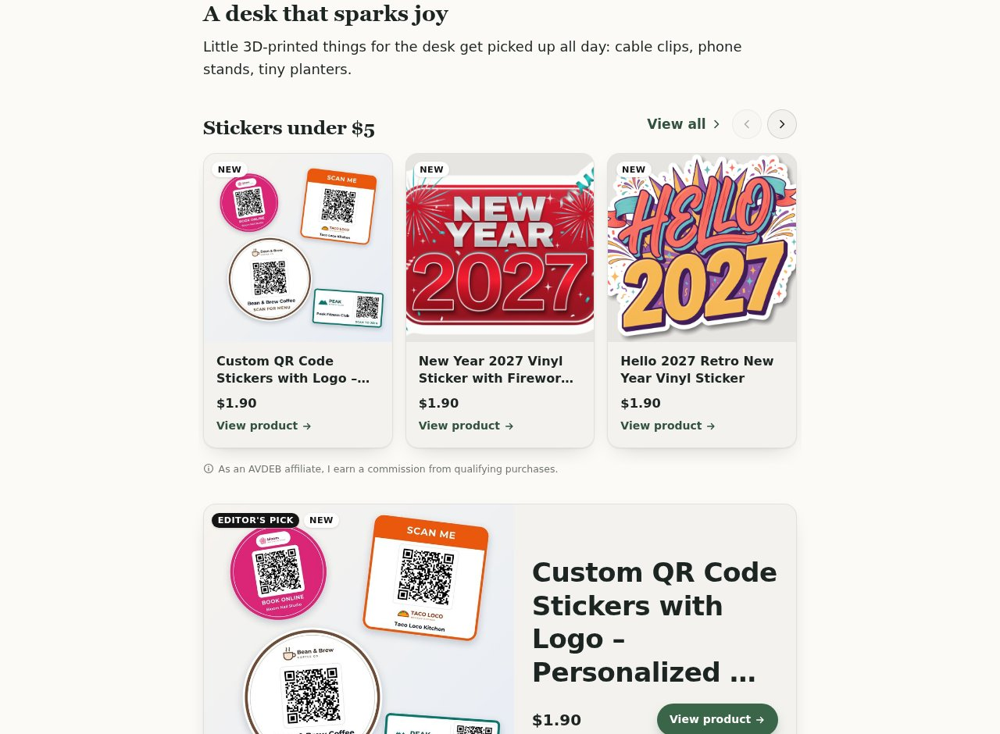

# AVDEB Products for Craft CMS

Show [AVDEB](https://avdeb.com/developers/#craft) products on your Craft site (a creator's shop, a category, a search or a single product) with **your affiliate referral code on every link**.



- **In templates:** `{{ avdebProducts({ url: 'https://avdeb.com/category/stickers/', layout: 'carousel' }) }}`, `avdebProduct()` and `avdebButton()`.
- **In content:** authors type `{avdeb-products https://avdeb.com/category/stickers/}` in CKEditor (or any rich text field) and your template outputs `{{ entry.body|avdeb }}`.
- **Four layouts:** grid, carousel (scroll-snap with keyboard and arrow buttons), list ("shop the post") and spotlight. Single products render as a horizontal card, a hero or a compact card, with your own badge and note.
- **Fits your design:** container queries let embeds adapt to the column they sit in. Choose inherit, light, dark or system theme, plus card style, accent colour, radius and image shape. Styles use `:where()` (zero specificity), so your CSS always wins, and `--avdeb-*` custom properties restyle everything. Or turn the stylesheet off and use `craft.avdeb.data()` for your own markup.
- **Fast and resilient:** products are fetched on the server and cached in Craft's cache (file, database or Redis). If AVDEB can't be reached, the last good copy is served for a week.
- **Honest links:** referral links get `rel="sponsored"`, and an optional affiliate disclosure appears under embeds that carry a code.
- **Private by default:** no third-party scripts, cookies, iframes or tracking. The only JavaScript is ~50 lines for the carousel arrows. The secret key stays on the server.

## Requirements

- Craft CMS 5.0 or later
- PHP 8.2 or later

## Installation

From the Plugin Store: *Settings → Plugins → Plugin Store*, search for “AVDEB”, and click *Install*.

Or with Composer:

```sh
composer require avdeb/craft-avdeb
php craft plugin/install avdeb
```

## Configuration

*Settings → Plugins → AVDEB Products*:

- **Referral code:** added as `?ref=` to every AVDEB link.
- **Secret key** (optional, `avdeb_sk_…`): your code is added automatically and embeds can show up to 48 products (12 without a key). Plugin settings are saved in project config, so put the key in `.env` and enter `$AVDEB_SECRET_KEY` in the field.
- **Display defaults:** layout, columns, card style, colour theme, accent colour, corner radius, image shape, button text, prices, designer names, badges, new tab.
- **Affiliate disclosure**, **stylesheet on/off** and **caching** (refresh interval, *Refresh products now*).

The status line at the top shows whether links are credited to you ("Connected as …" or the referral code in use) and the request stats.

When the fields are empty, the `AVDEB_SECRET_KEY` and `AVDEB_REF_CODE` environment variables are used. Every setting can also be set per environment in `config/avdeb.php`:

```php
<?php

use craft\helpers\App;

return [
    'apiKey' => App::env('AVDEB_SECRET_KEY') ?? '',
    'refCode' => 'YOURCODE',
    'layout' => 'carousel',
    'accentColor' => '#7c3aed',
    'cacheMinutes' => 360,
];
```

### Become an AVDEB affiliate

Free to join: 5% commission, 30-day cookie, monthly PayPal payouts in USD ($50 minimum), open worldwide.
Apply at [avdeb.com/affiliate/apply](https://avdeb.com/affiliate/apply/). After approval, copy your referral code (or create a secret key) in the [partner dashboard](https://avdeb.com/affiliate/dashboard/developers/) and paste it on the settings page.

## Usage

### Twig

```twig
{# Any AVDEB creator, category or product link; the source is detected automatically #}
{{ avdebProducts({ url: 'https://avdeb.com/creators/cleo/', heading: 'From my shop' }) }}

{{ avdebProducts({ tag: 'stickers', layout: 'carousel', columns: 4, limit: 10 }) }}
{{ avdebProducts({ q: 'keychain', layout: 'list', limit: 3 }) }}
{{ avdebProducts({ tag: '3d-prints', layout: 'spotlight', theme: 'dark', accent: '#e0a84f' }) }}

{{ avdebProduct('custom-qr-code-stickers', { variant: 'hero', badge: "Editor's pick", note: 'I use it every day.' }) }}

{{ avdebButton({ href: '/creators/cleo/', label: 'Visit my shop', variant: 'outline', align: 'center' }) }}
```

The same functions are available as `craft.avdeb.products()`, `craft.avdeb.product()` and `craft.avdeb.button()`.

Options: `url`, `creator`, `tag`, `type`, `q` (leave all empty for the newest products), `limit`, `layout` (grid, carousel, list, spotlight), `columns` (1–6), `heading`, `intro`, `headingLevel`, `viewAll`, `cardStyle` (elevated, outline, minimal), `theme` (site, light, dark, auto), `accent`, `radius` (0–32), `ratio` (square, portrait, landscape), `buttonText`, `hidePrice`, `hideCreator`, `newTab`. For a single product: `variant` (horizontal, hero, card), `badge`, `note`. For a button: `href`, `label`, `variant` (solid, outline, link), `align` (start, center, end).

### Tags in rich text

Authors can type tags straight into a CKEditor field:

```text
{avdeb-products https://avdeb.com/creators/cleo/ layout="carousel" limit="8" heading="From my shop"}
{avdeb-products https://avdeb.com/category/stickers/ layout="list" limit="3"}
{avdeb-product https://avdeb.com/store/custom-qr-code-stickers/ variant="hero" badge="Editor's pick"}
{avdeb-button href="/creators/cleo/" label="Visit my shop" variant="outline" align="center"}
```

Output the field through the filter:

```twig
{{ entry.body|avdeb }}
```

A tag alone in a paragraph replaces the whole paragraph. Write `{{avdeb-products}}` to show a tag as text.

### Your own markup

```twig

<ul>
  
    <li><a href="{{ card.href }}" rel="{{ card.rel }}"> {{ card.title }} — {{ card.price }}</a></li>
  
</ul>
<small>{{ result.disclosure }}</small>
```

Each card has `href` (with your referral code), `rel`, `target`, `title`, `image`, `width`, `height`, `price`, `compareAt`, `discount`, `isNew` and `creator`. Raw API products are in `result.products`, the "view all" link in `result.viewAll`.

## Styling

Every rule is `:where()`-wrapped, so your CSS wins. Set tokens in your stylesheet:

```css
.avdeb {
  --avdeb-accent: #7c3aed;
  --avdeb-radius: 4px;
  --avdeb-card-bg: #fff;
  --avdeb-font-title: Georgia, serif;
}
```

Tokens: `--avdeb-accent`, `--avdeb-accent-contrast`, `--avdeb-surface`, `--avdeb-card-bg`, `--avdeb-card-pad`, `--avdeb-border`, `--avdeb-muted`,
`--avdeb-badge-bg`, `--avdeb-badge-text`, `--avdeb-shadow`, `--avdeb-shadow-hover`, `--avdeb-radius`, `--avdeb-ratio`, `--avdeb-gap`, `--avdeb-pad`,
`--avdeb-font-title`, `--avdeb-heading-size`, `--avdeb-title-size`, `--avdeb-price-size`, `--avdeb-btn-bg`, `--avdeb-btn-color`, `--avdeb-btn-shadow`.

The markup uses stable BEM classes (`.avdeb`, `.avdeb--{layout}`, `.avdeb-card`, `.avdeb-card__title`, `.avdeb-card__price`, `.avdeb-btn`…). To replace the stylesheet entirely, turn off *Load the AVDEB stylesheet and carousel script* (or set `'includeAssets' => false`). Carousels still scroll without the script; embeds added after page load (Sprig, htmx) can call `window.AvdebProducts.init(element)`.

## How it works

- The functions call `https://api.avdeb.com/v1/catalog/products` from the server (Guzzle). With a secret key, requests send `Authorization: Bearer avdeb_sk_…` and the API returns links that already carry your code; without one, `?ref=` is added to every link.
- Responses are cached per query in Craft's cache. A failed request serves the last good result (up to a week old) and retries after 15 minutes; at most 30 API calls a minute are made. Identical embeds on one page share one lookup.
- *Refresh products now* (or *Utilities → Caches → AVDEB product data*, or `php craft clear-caches/avdeb-products`) drops the cached products. If you wrap embeds in ``, that template cache has its own lifetime.
- All product data is validated before rendering: only `https://avdeb.com` links and `https://` images get through, and every value is escaped.

## Development

```sh
php tests/run.php            # unit tests for the catalog client, options and renderer (no Craft needed)
tests/dev-site.sh            # throw-away Craft 5 site in Docker with the plugin, CKEditor and a blog → http://localhost:8094/admin
```

## Support

Issues and ideas: [github.com/Avdebcom/craft-avdeb/issues](https://github.com/Avdebcom/craft-avdeb/issues). More integrations: [avdeb.com/developers](https://avdeb.com/developers/).

## License

MIT © AVDEB
